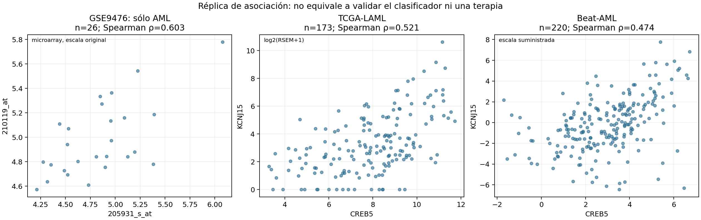

# Leukemia Biomarker Discovery and Bioelectric Analysis

This repository combines microarray-based biomarker discovery, a neural-network classification workflow, external RNA-seq association analysis and exploratory PhysiCell simulations of hypothetical bioelectric rules in acute myeloid leukemia (AML).

External analyses support positive **CREB5–KCNJ15 coexpression** in TCGA-LAML and Beat AML. These findings do not establish a specific CREB5-AS1 signal, causal regulation, reversal of immunosuppression, therapeutic efficacy or external predictive performance of the neural network.

[Project archive DOI](https://doi.org/10.5281/zenodo.20208524)

## Research components

| Component | Purpose | Current scope |
|---|---|---|
| Microarray discovery | Explore expression differences and rank informative probes in GSE9476 | Exploratory analysis of AML and reference sample groups |
| Neural network | Classify the five groups represented in the discovery matrix | Internal cross-validation workflow; external predictive performance remains unestablished |
| External RNA-seq analysis | Examine whether CREB5–KCNJ15 coexpression persists in independent AML cohorts | Positive association replicated in TCGA-LAML and Beat AML |
| PhysiCell simulations | Explore the consequences of programmed voltage-dependent cellular rules | Historical outputs, recovered XML and a separately identified C++ reconstruction |

The discovery classes are `AML`, `Bone_Marrow`, `Bone_Marrow_CD34`, `PB` and `PBSC_CD34`. They describe AML and reference sample groups, rather than five molecular AML subtypes.

## External RNA-seq association replication

The primary comparison uses the **26 AML observations** from GSE9476, rather than pooling AML with the reference groups.

| Cohort | Unique patients or discovery observations | Spearman rho | Bootstrap 95% CI | BH adjusted p |
|---|---:|---:|---:|---:|
| GSE9476, AML discovery subset | 26 | 0.603 | 0.253–0.829 | Not included in the external testing family |
| TCGA-LAML | 173 | 0.521 | 0.401–0.625 | 0.00001 |
| Beat AML, de novo subset | 220 | 0.474 | 0.347–0.587 | 0.00001 |

The external effects are smaller than the discovery estimate but retain the same positive direction. Benjamini–Hochberg correction covers four external tests: primary Spearman and secondary Pearson analyses in each cohort. It does not correct the historical genome-wide feature search. Spearman p values reach the minimum resolution of 99,999 random permutations; they are not exact tail probabilities. Confidence intervals use 10,000 patient bootstrap replicates. This analysis was not preregistered.



The [external RNA-seq README](validation/external_rnaseq/README.md) contains cohort selection, normalization details, statistical methods, limitations and reproduction commands. Supporting files include:

- [Full external test results](validation/external_rnaseq/results/external_tests.csv).
- [Cohort counts, software versions and source checksums](validation/external_rnaseq/results/results.json).
- [Extracted expression values and selected sample identifiers](validation/external_rnaseq/data/selected_samples_expression.csv).
- [Detailed Spanish report](validation/external_rnaseq/reports/INFORME_ES.txt).

## Target annotation and interpretation

The historical analysis labelled probe `205931_s_at` as `LOC401317` and paired it with KCNJ15 probe `210119_at`. The historical annotation associates the first probe with `NM_004904` and `CREB5 /// LOC401317`. NCBI retired [LOC401317, GeneID 401317](https://www.ncbi.nlm.nih.gov/gene/401317), replacing it with [CREB5, GeneID 9586](https://www.ncbi.nlm.nih.gov/gene/9586).

The external matrices contain CREB5 and KCNJ15. The replication is therefore described as **CREB5–KCNJ15**, without attributing the signal specifically to an antisense transcript named CREB5-AS1. Probe sequences have not been remapped to establish transcript specificity. `NR_024040.1` is associated with CSGALNACT1 and is not treated as an interchangeable identifier for this hypothesis.

Historical filenames and simulation variable names retain their original labels for traceability. Their presence does not resolve these annotation questions. The CHOPCHOP files are computational design outputs, not measurements of cellular activation or therapeutic response.

## Project structure

Selected files and directories currently provided in the repository:

```text
.
├── data/
│   ├── Leukemia_GSE9476.csv
│   └── chopchop/
│       ├── gene_file.fa
│       └── results.tsv
├── models/
│   └── modelo_leucemia.keras
├── physicell/
│   ├── PhysiCell_settings.xml
│   ├── custom_modules/
│   │   ├── custom.cpp
│   │   └── custom.h
│   ├── output_control/
│   ├── output_crispra/
│   └── output_rosi/
├── scripts/
│   ├── Red_Neuronal_CuMiDa.ipynb
│   ├── analisis_subtipos.py
│   └── validacion_genomica.py
├── plots/
│   ├── correlacion_kcnj15_loc401317.png
│   ├── grafica_resultados_AML.png
│   ├── heatmap_subtipos_top20.png
│   ├── reporte_interactivo.html
│   ├── sobreexpresion_kcnj15.png
│   └── sobreexpresion_loc401317.png
├── results/
│   └── biomarkers.csv
├── validation/
│   ├── model_recovery/
│   │   ├── LEEME.txt
│   │   ├── reconstruir.py
│   │   ├── predecir.py
│   │   ├── modelo_inferencia_numpy.npz
│   │   ├── preprocesamiento_reconstruido.joblib
│   │   ├── sondas_500_ordenadas.csv
│   │   ├── predicciones_candidato.csv
│   │   └── verificacion.json
│   └── external_rnaseq/
│       ├── README.md
│       ├── DATA_ATTRIBUTION.txt
│       ├── SHA256SUMS.txt
│       ├── requirements.txt
│       ├── data/
│       ├── figures/
│       ├── reports/
│       ├── results/
│       └── scripts/
├── CITATION.cff
├── LICENSE
├── README.md
└── requirements.txt
```

This root README provides the project overview. The README inside `validation/external_rnaseq/` documents that analysis in detail; its scripts and requirements are separate from the original machine-learning workflow.

## Data requirements and reproducibility

### Discovery matrix and candidate model recovery

The complete prepared discovery matrix is included at `data/Leukemia_GSE9476.csv`. It contains 64 samples, 22,283 probe features, sample identifiers and five labels: AML, Bone_Marrow, Bone_Marrow_CD34, PB and PBSC_CD34. These represent AML and reference sample groups, not five molecular AML subtypes. The historical preprocessing from the original GEO data to this prepared matrix remains undocumented.

Candidate model recovery artifacts are available in `validation/model_recovery/`. Reconstructing the five stratified folds defined in the historical notebook uniquely reproduces the original top-20 probe ranking in fold 5, including its F-statistics within numerical precision. The original ranking is preserved at `results/biomarcadores.csv`, the path expected by the reconstruction script.

Combining the reconstructed fold-5 preprocessing with the original local model weights correctly classifies all 12 reconstructed fold-5 test samples using NumPy inference. This single-fold result does not verify the previously reported 98.3% cross-validation accuracy or establish external predictive performance.

The ranking match strongly supports the recovered selector's association with fold 5, but does not independently establish the training provenance of the saved weights. Direct comparison against TensorFlow inference remains pending.

The recovery directory includes the reconstructed scaler, feature selector and class encoder; the ordered 500 selected probes; a portable NumPy inference model; candidate predictions; reconstructed partitions; source checksums; and reconstruction and inference scripts. The historical notebook and original Keras model are retained separately for traceability.

### External RNA-seq data

The external analysis uses cBioPortal Datahub studies `laml_tcga` and `aml_ohsu_2018`, pinned to commit `e1b75cd25bf7436d16719b7d76117ad8f3f66e54`. These are RNA-seq cohorts from historical studies, not newly collected 2026 cohorts.

The large source matrices are downloaded by script rather than stored in this repository. Extracted values, selection metadata, source hashes and attribution are included under `validation/external_rnaseq/`.

For a small offline numerical verification, run from the repository root:

```bash
python -m pip install -r validation/external_rnaseq/requirements.txt
python validation/external_rnaseq/scripts/verify_results.py
```

For the full download, cohort selection, bootstrap and permutation analysis, follow the commands in the [external analysis README](validation/external_rnaseq/README.md#reproduce-the-analysis).

## Neural-network model

The saved model uses 500 inputs, dense layers of 128 and 64 units, dropout rates of 0.5 and 0.3, L2 regularization and five output classes. The notebook shows scaling, feature selection and SMOTE fitted within each training fold.

The serialized scaler, selected probe order and class encoder were not located. Applying RNA-seq measurements directly to the 500 input positions would therefore not constitute a valid external evaluation. Cross-platform mapping and compatible external labels are also required.

Dropout reduces overfitting risk but does not establish generalization. The external association analysis does not measure the classifier's accuracy, AUC or degree of overfitting. See the [model configuration audit](validation/external_rnaseq/reports/model_config_audit.json) and [detailed report](validation/external_rnaseq/reports/INFORME_ES.txt).

## PhysiCell simulations

The repository provides [recovered XML settings](physicell/PhysiCell_settings.xml), a [reconstructed C++ module](physicell/custom_modules/custom.cpp) and its [header](physicell/custom_modules/custom.h), compatible with PhysiCell 1.14.1. The reconstructed module was compiled and checked in a separate PhysiCell source checkout. The PhysiCell engine, template main program and Makefile are not included in the published directory shown above.

For integration, start with a clean [PhysiCell 1.14.1 source checkout](https://github.com/MathCancer/PhysiCell/tree/1.14.1). Run `make template` first, then copy the provided `custom.cpp` and `custom.h` into its `custom_modules/` directory and the provided XML into `config/PhysiCell_settings.xml`. Compile and run from the PhysiCell directory. Running `make template` again after copying would replace the custom project files.

The original C++ source that produced the archived outputs was not located. The supplied reconstruction documents observed values and assumed conditions; it is not claimed to reproduce the historical trajectories exactly. A guard against modifying dead-cell cycle rates is a documented change that can affect corpse persistence.

The historical CRISPRa scenario stores an apoptosis rate of `9e9/min`, which saturates the native event probability and forces death in the simulation. The resulting extinction is a consequence of that programmed rule, not an independently measured treatment effect. Immune recognition is not modelled mechanistically.

The original population figure counted SVG circles, including nuclei and dead cells. It should not be interpreted as a direct live-cell count. Population analyses should use saved live/dead states and actual simulation times. Archived output folders contain saved states and spatial representations, rather than a complete record of the original source code.

## Interpretation and limitations

The replicated association supports further investigation of CREB5 and KCNJ15 expression in AML. Potential influences include cell composition, blast percentage, tissue, disease subtype, treatment and batch. These factors have not been fully adjusted in the external analysis.

Coexpression does not establish causal regulation or membrane-potential changes. The simulations explore hypotheses rather than validate a CRISPRa or rosiglitazone therapy. The external replication and the neural-network classification task should be assessed separately.

## Sources and attribution

- [GSE9476 discovery study](https://www.ncbi.nlm.nih.gov/geo/query/acc.cgi?acc=GSE9476).
- The Cancer Genome Atlas Research Network. *Genomic and Epigenomic Landscapes of Adult De Novo Acute Myeloid Leukemia*. [DOI: 10.1056/NEJMoa1301689](https://doi.org/10.1056/NEJMoa1301689).
- Tyner et al. *Functional genomic landscape of acute myeloid leukaemia*. [DOI: 10.1038/s41586-018-0623-z](https://doi.org/10.1038/s41586-018-0623-z).
- Ghaffarizadeh et al. *PhysiCell: An open source physics-based cell simulator for 3-D multicellular systems*. [DOI: 10.1371/journal.pcbi.1005991](https://doi.org/10.1371/journal.pcbi.1005991).

The repository [LICENSE](LICENSE) applies to its software as stated there. External data retain their source attribution and applicable provider terms; see [DATA_ATTRIBUTION.txt](validation/external_rnaseq/DATA_ATTRIBUTION.txt).
