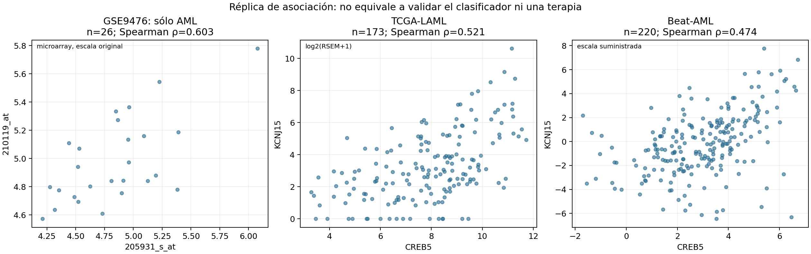

# External RNA seq replication of CREB5 and KCNJ15 coexpression

The positive CREB5–KCNJ15 association was reproduced in two external AML RNA-seq cohorts: TCGA-LAML and Beat AML. This is an exploratory replication of an expression association. It does not establish a specific CREB5-AS1 signal, validate the saved neural network, or demonstrate therapeutic efficacy.

## Results

| Cohort | Unique patients | Spearman rho | Bootstrap 95% CI | BH adjusted p |
|---|---:|---:|---:|---:|
| GSE9476, AML subset, discovery | 26 | 0.603 | 0.253–0.829 | Not part of external testing family |
| TCGA-LAML | 173 | 0.521 | 0.401–0.625 | 0.00001 |
| Beat AML, de novo subset | 220 | 0.474 | 0.347–0.587 | 0.00001 |

The Spearman p values use 99,999 random two-sided permutations with the plus-one correction. The reported value reaches the minimum resolution of this procedure; it is not an exact tail probability. Confidence intervals use 10,000 paired patient bootstrap replicates. Random seed: 42.

Benjamini–Hochberg correction covers four external tests: Spearman and secondary Pearson tests in each of the two cohorts. It does not cover the historical genome-wide feature search or establish genome-wide FDR control. This analysis was not preregistered. Full precision results, including the secondary tests, are in [external_tests.csv](results/external_tests.csv).

The external effects are smaller than the AML discovery estimate but retain the same direction. These findings do not establish equivalence of effect sizes. The earlier pooled discovery correlation mixed AML and reference groups and is not the comparator used here.



## Target annotation

The original microarray analysis used probe `205931_s_at` under the name `LOC401317`, paired with KCNJ15 probe `210119_at`. The historical annotation associates `205931_s_at` with `NM_004904` and `CREB5 /// LOC401317`. NCBI retired GeneID 401317 and replaced it with [CREB5, GeneID 9586](https://www.ncbi.nlm.nih.gov/gene/401317).

Both external matrices contain CREB5 and KCNJ15, but no LOC401317 row. The replication is therefore labelled **CREB5–KCNJ15**. Probe sequences were not remapped to establish transcript specificity, and these gene-level data do not establish a separate CREB5-AS1 signal. `NR_024040.1`, associated with CSGALNACT1, was not used as a substitute.

## Data and cohort selection

Data were downloaded on 1 November 2026 from cBioPortal Datahub at commit `e1b75cd25bf7436d16719b7d76117ad8f3f66e54`.

- **TCGA-LAML:** study `laml_tcga`, Firehose Legacy, normalized RNA Seq V2 RSEM. The matrix contained 173 expression samples. Selecting primary samples with finite measurements for both genes retained 173 unique patients.
- **Beat AML:** study `aml_ohsu_2018`, RNA Seq RPKM-labelled profile. Of 451 expression samples, 222 had the selected de novo timepoint, AML patient diagnosis and finite measurements for both genes. Selecting one sample per patient retained 220 patients. When several eligible samples existed, marrow was preferred, followed by sample identifier order. This order was not interpreted as collection time.

The Beat AML timepoint filter does not by itself prove absence of prior treatment. These are RNA-seq cohorts from historical studies, not newly collected 2026 cohorts. Cohorts were analysed separately. The complete matrices are downloaded by the script rather than committed to this repository.

Spearman uses ranks of the supplied expression values. Secondary Pearson uses `log2(RSEM+1)` in TCGA and the supplied values in Beat AML. The Beat AML matrix includes negative values; it was not treated as untransformed nonnegative RPKM or logged again. Its exact transformation is not specified in the profile metadata. This limitation particularly affects interpretation of the secondary Pearson analysis.

Beat AML descriptive sensitivity estimates remain positive within marrow samples, rho 0.381, n=139, and peripheral blood, rho 0.619, n=77. These are not covariate-adjusted or additional confirmatory tests. Cell composition, blasts, subtype, age, treatment and batch remain possible influences.

## Reproduce the analysis

Use Python 3.12 and install the tested scientific dependencies:

```bash
python -m pip install -r requirements.txt
```

For a small offline verification of patient uniqueness, correlations and BH adjustment:

```bash
python scripts/verify_results.py
```

To download the pinned source matrices, repeat cohort selection and rerun the bootstrap and permutation analysis, run these commands **from this directory**:

```bash
python scripts/download_data.py --destination data_download
python scripts/run_validation.py --data data_download --discovery data/discovery_aml_pair.csv --output reproduced
```

The download is approximately 156 MB plus metadata. `data_download/` and `reproduced/` are excluded by the local `.gitignore`. The included discovery CSV contains only the two original probe measurements for the 26 AML observations, in their original order, so reproduction does not depend on the empty discovery CSV previously committed at repository root.

Source hashes, cohort counts, software versions, resampling settings and full numerical results are in [results.json](results/results.json). The offline check does not repeat source cohort selection or resampling; those are repeated by the full analysis command.

## Scope of model validation

The saved Keras configuration contains a 500-feature input, dense layers of 128 and 64 units, dropout rates of 0.5 and 0.3, L2 regularization and five output classes. The classes in the discovery data describe AML and reference sample groups, not five molecular AML subtypes.

No external network predictions, accuracy or AUC are reported. The serialized scaler, selected probe order and class encoder were not found, and transport from microarray probes to RNA-seq inputs has not been defined. The selected external cohorts contain AML rather than all five reference classes. A valid external predictive evaluation requires the frozen preprocessing pipeline, a documented cross-platform mapping and compatible external labels.

Dropout reduces overfitting risk but does not establish generalization. Replication of this two-gene association does not measure the classifier's overfitting and does not validate voltage, immune recognition or CRISPRa/rosiglitazone effects.

The Spanish report contains the full model audit and limitations: [INFORME_ES.txt](reports/INFORME_ES.txt).

## Sources and attribution

- [Pinned TCGA-LAML distribution](https://github.com/cBioPortal/datahub/tree/e1b75cd25bf7436d16719b7d76117ad8f3f66e54/public/laml_tcga).
- [Pinned Beat AML distribution](https://github.com/cBioPortal/datahub/tree/e1b75cd25bf7436d16719b7d76117ad8f3f66e54/public/aml_ohsu_2018).
- The Cancer Genome Atlas Research Network. *Genomic and Epigenomic Landscapes of Adult De Novo Acute Myeloid Leukemia*. [DOI: 10.1056/NEJMoa1301689](https://doi.org/10.1056/NEJMoa1301689).
- Tyner et al. *Functional genomic landscape of acute myeloid leukaemia*. [DOI: 10.1038/s41586-018-0623-z](https://doi.org/10.1038/s41586-018-0623-z).
- [cBioPortal expression processing documentation](https://docs.cbioportal.org/user-guide/faq/).

Data attribution and source terms are described in [DATA_ATTRIBUTION.txt](DATA_ATTRIBUTION.txt). Analysis scripts were prepared with AI assistance and checked against the supplied numerical results; the checked components and remaining limits are recorded in the verification files. No independent third-party methodological review is claimed.
